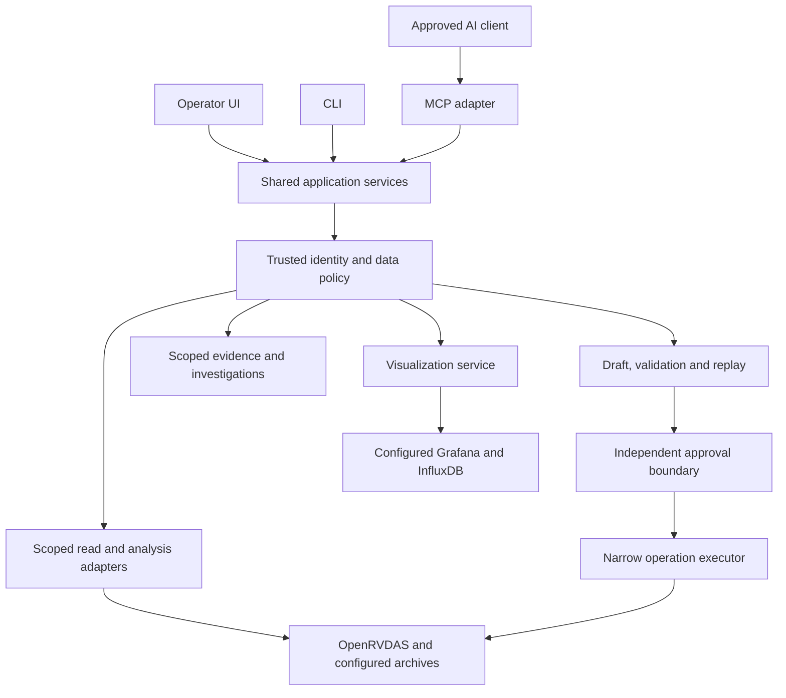

# DeepSignal program architecture

Canonical program architecture reference, established 2026-11-21 at Eugene's
request. The [feature reference](REFERENCE.md) tracks scope; the
[handover](CODEX-HANDOVER.md) records exact candidates and current evidence.
This document describes required structure, not a production-readiness claim.

## Product and shared services

DeepSignal is an optional operational layer over OpenRVDAS. Native acquisition
and native administration remain independently usable. Linux is the deployment
target; macOS and isolated cloud runners provide guarded development evidence.

UI, CLI and MCP call the same application services: catalog and deployment
identity; live/history queries; deterministic analysis and QC; configuration
drafts, validation and isolated replay; investigations and artifacts; visualization;
and separately authorized operations. MCP is an interface, not a second engine.
Scientific results come from versioned deterministic code, never model arithmetic.

The diagram shows logical boundaries. Every entry point and artifact retrieval
must enforce the same server-owned policy; drawing a box does not establish that
isolation. The executor and production identity boundary are not implemented by
the current fixture. Grafana publication uses the independent approval path too.

## OpenRVDAS integration and compatibility

Support discovery, acquisition health and events, bounded live/archive data,
configuration inspection/authoring, validation/replay, investigation and proven
management operations. Reuse standard Reader/Transform/Writer/DASRecord/CDS and
actual backend APIs. Do not assume every deployment has the same manager, archive,
loaded-state reporting or history. Advertise only qualified capabilities for a
pinned backend/version; unsupported and unknown remain visible.

One catalog supplies UI, MCP, CLI and Grafana mappings. One bounded upstream
subscription can fan out locally where supported. External sources keep their
identity, original timestamps, units, flags and coverage. Raw records remain
immutable; derived/corrected layers retain provenance and independent scientific
approval. Missing/stale/unknown are never replaced by fabricated observations.

## Security and AI data access

The authoritative requirements are
[Security Architecture section 17](SECURITY-ARCHITECTURE.md#17-mcp-access-and-ai-disclosure-required-production-boundary).
Read it before adding/changing an MCP tool, identity, data source, export,
remote connection, AI provider, approval or operational executor.

Full integration never grants unrestricted access. Authentication, scoped data
authorization and approved disclosure apply to reads as well as writes. An
approved cloud AI may receive data returned by its client; stdio and read-only
access alone do not contain it. Production must enforce the data-release decision
before returning results. An unmanaged client cannot be trusted to enforce a
server-side provider restriction after it already has the data.

No production security claim, real-data remote enablement or live operation is
authorized by this document. Required implementation, independent review and
deployment approval remain gates. Existing security decisions continue to apply;
historical proposed technologies are not silently promoted to implemented controls.

## Evidence, approvals and safe execution

Results carry versioned contracts, explicit deployment and artifact identities,
source/interval/method provenance, coverage, limits and honest result states.
Artifact IDs locate evidence; they do not grant permission. Recheck authorization
on every retrieval and export, including nested evidence and metadata.

Drafts and replay never imply deployment. Approved operations bind the exact
deployment, base revision, draft, checks, actions, expiry and independent operator.
Durable intent, duplicate prevention, conflict handling and unknown-outcome
reconciliation precede automatic retries. No generic command/file/SQL execution
interface is part of the MCP contract. Disabling DeepSignal must leave acquisition
working; safety for acquisition does not authorize unrestricted data disclosure.

## Delivery, resources and recovery

Existing Relay owns deterministic build/test dispatch and receipts; engineering
providers remain interchangeable. Kalon owns the sole shared MacBook/Mini resource
allocator. Preserve separate project queues, worktrees, policies and evidence.
Local guards remain authoritative; unknown capacity/reservations prevent new
intensive jobs. See [operating system](OPERATING-SYSTEM.md#deterministic-orchestration-2026-11-20-standing-directive).

Acceptance binds source, dependencies, policy and generated assets to an exact
candidate. Reuse valid evidence; retain failures and HOLDs. Compilation, fixture
tests, real-backend conformance, independent review, package and live deployment
are separate claims. A model quota reset is not ownership transfer: reconcile
actual workers and durable receipts before resuming. Keep bounded recovery
checkpoints and normal Git synchronization; never clear uncertain owners by age.

## Current verified scope and next gates

Console and Stream Health view fixture pilots qualified at b67f3072. Workspace
candidate58fbde8c passed Relay R5 and Linux workspace tests, including actual SDK
MCP, CLI and Chromium. Its unchanged Linux security policy failed. Current MCP
is a local stdio fixture with synthetic data, OS-account trust and no live executor.
The loopback HTTP demo is not production authentication. Full program security,
real manager/archive integration and Grafana are not qualified.

[Master tickets](MASTER-PRODUCT-TICKETS.md) cover M0-M5 and G1-G6. Product
`contrib/deepsignal/workspace/DEMO-STORIES.md` defines ten fake-cruise user stories:
current fixture, then real pinned OpenRVDAS acquisition with simulated sensors and
a real archive, then separately qualified Grafana and approved lab operations.
Each story needs exact input/reference evidence, ordinary-interface and MCP
results, failure cases and applicable independent science/security/usability review.
